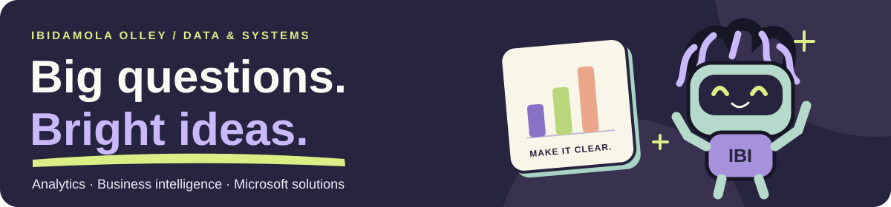

# Hi, I’m Ibidamola Olley 👋

**Data analytics · Power BI · Data science · Microsoft solutions**

I turn business questions into clear reports, reliable analysis, and practical tools. I’m a **System and Data Analyst at the NSW Department of Planning, Housing and Infrastructure (DPHI)**, with experience across government, higher education and local government in Australia, and an earlier foundation in engineering and IT in Nigeria.

My work brings together data, systems, and the people who use them. I’m interested in **Data Analyst, Data Scientist, and Power BI Developer** opportunities.

**[Explore my portfolio ↗](https://olleyibi.github.io/)** · **[Download my full career CV (PDF)](https://olleyibi.github.io/Ibidamola-Olley-Resume.pdf)** · **[LinkedIn](https://www.linkedin.com/in/ibidamola-olley/)** · **[Email me](mailto:Ibidamola.olley@gmail.com)**

### Career highlights

- **Automation with a measurable result:** reduced user-access cleanup from one week to one day using Power Automate.
- **End-to-end Microsoft solutions:** Power BI reporting, hierarchy-based access, cost recovery reporting, and coaching registration with Power Apps and Power Automate.
- **An engineering foundation:** generator electrical checks and overhaul support at Biswal, plus solar installations and network setup at Dotmac in Nigeria.
- **PRINCE2 Foundation certified:** practical delivery experience supported by formal project management certification.

The CV includes all six roles across Australia and Nigeria, with expanded responsibilities for my early engineering and IT experience.

## What I bring

- **Reporting people can use:** Power BI dashboards, paginated reports, DAX measures, and data models shaped around business questions.
- **Data people can trust:** SQL, Python, and R for analysis, integration, validation, and migration checks.
- **Microsoft tools that work together:** solutions using Power Apps, Power Automate, SharePoint, Microsoft Forms, Dataverse, and Power BI.
- **Analysis with context:** statistical modelling, time-series analysis, model evaluation, and clear explanations of limitations.

## Technical toolkit

| Area | Tools and methods |
| --- | --- |
| Business intelligence | **Power BI**, DAX, Power Query, Tableau, Excel, SSRS, Report Builder |
| Programming and databases | **SQL, Python, R**, SQL Server, Oracle, MySQL |
| Apps and automation | **Power Apps, Power Automate**, SharePoint, Microsoft Forms, Dataverse |
| Data foundations | Data modelling, ETL, dataflows, data quality, migration validation |
| Analysis and modelling | Regression, generalised additive models (GAMs), statistical testing, time series, model evaluation |

**Microsoft Fabric:** hands-on training. **Azure:** familiarity. **Development tools:** Git, GitHub, and RStudio.

## Selected work

These portfolio stories explain the business question, my approach, and the outcome. They use general descriptions and, where illustrated, fictional data to protect client information.

- **[Portfolio reporting with Power BI](https://olleyibi.github.io/project-reporting/)** — dashboards and paginated reports that help project, program, and portfolio managers understand performance.
- **[User lifecycle automation](https://olleyibi.github.io/project-automation/)** — connecting SQL Server, SharePoint, Dataverse, and Power Automate to improve access checks and licence oversight.
- **[Research data migration validation](https://olleyibi.github.io/project-migration/)** — repeatable checks in R to compare systems and make migration progress and discrepancies easier to track.

**[See all project stories →](https://olleyibi.github.io/work/)**

## Explore the code

These repositories are **learning and coursework projects** that show how I practise analytical and development techniques.

| Project | What to explore | Tools |
| --- | --- | --- |
| [Regression modelling pipeline](https://github.com/olleyibi/ibimlprojects) | Data preprocessing, model comparison, and a Flask prediction interface | Python, scikit-learn, Flask |
| [Customer churn classification](https://github.com/olleyibi/ann_classification_churn_practice) | A neural-network classifier with a Streamlit interface; Udemy coursework | Python, TensorFlow/Keras, Streamlit |
| [Gaussian mixture models](https://github.com/olleyibi/A3-Gaussian-mixture-models) | Expectation-maximisation with full covariance matrices; university coursework | MATLAB, statistical modelling |

## Career history

My work spans data and systems analysis in Australia and engineering and IT experience in Nigeria.

### System and Data Analyst | Department of Planning, Housing and Infrastructure (DPHI)

**Jan 2023 - Present · Australia**

- Undertake data-management responsibilities across multiple teams, supporting project, program and portfolio managers with Power BI dashboards and paginated reports covering finance, timesheets, risks, issues, deliverables and milestones.
- Gather stakeholder requirements and translate business questions into data models, ETL processes and reporting specifications. Refine layouts and terminology through user feedback and configure row-level security around business-unit hierarchies.
- Automated user-access checks using Power Automate, reducing cleanup from one week to one day. Integrated SQL Server, SharePoint and Dataverse records to support onboarding, de-onboarding, role changes and exception reporting for access and licence oversight.
- Built a coaching-registration solution with Power Apps and Power Automate so users could select available sessions and automatically join guest lists, reducing repetitive manual administration for the team.
- Provided senior analyst cover during a secondment. Worked with the reporting manager and data owner to trace incorrect billable amounts to Excel formula errors and correct the source calculations.
- Coordinate vendors on system requirements, upgrades and change requests. Test upgrades against provided guidelines to verify expected functionality and support ongoing system improvements.

### Impact and Engagement Data Officer | University of New England

**Jan 2022 - Jan 2023 · Australia**

- Used SQL in Oracle and Microsoft environments, together with Python and R, to extract, transform, integrate and validate research data from enterprise systems and API connections.
- Developed R scripts to compare research data and metadata across on-premise and cloud systems during migration. Ran checks at migration intervals and used dashboards to report progress and error percentages.
- Created training documentation and mentored colleagues in Power BI and Research Services applications, supporting consistent use of reporting tools and business systems.
- Backfilled the Research Services System Administrator, coordinating maintenance and administration across the Research Information Management Systems application portfolio.

### Data Analyst | AtOnce.Biz

**Oct 2021 - Jan 2022 · Australia**

- Worked with cross-functional teams to define data structures and collection methods for insights communicated to executive stakeholders.
- Created dashboards and standard and ad-hoc reports for marketing and senior management, including analysis of advertising campaign results.
- Normalised and validated information from multiple sources into consistent databases and models for use across functional teams.
- Helped identify data-quality issues and structural defects affecting pipelines into the data warehouse.

### ICT Business Support Analyst | Uralla Shire Council

**Apr 2021 - Oct 2021 · Australia**

- Coordinated training with IT system managers and maintained guides for technical and non-technical users of Council systems.
- Coordinated testing of system fixes, new functionality, reports, integrations and cloud upgrades with business stakeholders; documented issues and resolutions.
- Gathered CIVICA cloud requirements and mapped the scope and resourcing for data remediation and new work packages.
- Documented technical and physical change requests through the ITIL ticketing process and worked with cloud engineers on changes to Citrix environments.
- Performed routine cloud-system and equipment checks and raised issues affecting day-to-day business processes and system functionality.

### Graduate Engineering Trainee - Diesel Engine Overhaul | Biswal Limited

**Nov 2019 - Mar 2020 · Nigeria**

- Assisted with inspection and troubleshooting of electrical components in diesel-generator systems, supporting the workshop team in identifying faults during overhaul work.
- Supported supervised checks of batteries, starter motors, alternators and associated wiring to help identify issues affecting generator starting and electrical operation.
- Assisted with engine dismantling and component inspection during overhaul, helping the workshop team assess the condition of engine parts.
- Supported engine reassembly following overhaul, developing practical understanding of how mechanical and electrical components work together in diesel-generator systems.
- Recorded maintenance activities and followed workshop safety procedures throughout inspection, dismantling and reassembly tasks.

### Information Technology Intern | Dotmac Technologies

**Jan 2017 - Jul 2017 · Nigeria**

- Assisted the technical team with solar power system installations, applying electrical engineering knowledge in a practical renewable-energy installation setting.
- Helped install network racks incorporating routers and switches, supporting the physical setup of equipment used in network infrastructure.
- Assisted with router and switch configuration during network setup, connecting hands-on equipment installation with the settings needed for network communication.

[View my full experience and responsibilities →](https://olleyibi.github.io/experience/)

## Education and professional development

**Master of Data Science**, University of New England · **BEng, Electrical & Electronics Engineering**, Landmark University.

**PRINCE2 Project Management Foundation (Version 7)** — certified by PeopleCert, effective **21 October 2026**; renew by **21 October 2029**.

My professional development also includes Microsoft Fabric, Azure data engineering, advanced DAX, Power BI dataflows and paginated reporting, Power Apps, Power Automate, and SharePoint.

**[Explore my experience](https://olleyibi.github.io/experience/)** · **[View certifications and training](https://olleyibi.github.io/training/)**

## A little beyond the data

I enjoy philosophy, travel, football, basketball, and video games. Curious questions and good conversations are always welcome.

My portfolio also has **IBI**, a robot with dreads and an enthusiastic supply of AI jokes. [Meet him here](https://olleyibi.github.io/).

**Have a reporting challenge, an automation idea, or a role in mind? [Let’s talk.](https://olleyibi.github.io/#contact)**
