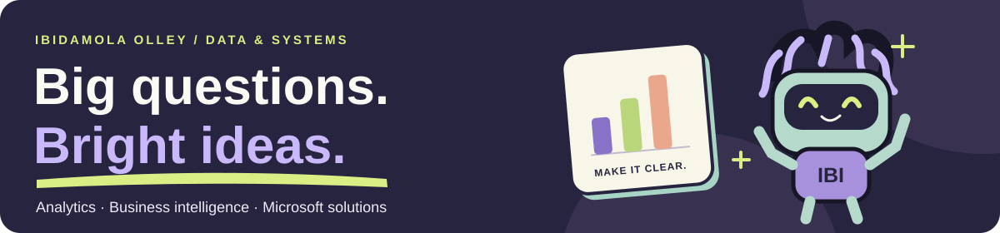

# Hi, I’m Ibidamola Olley 👋

**Data analytics · Power BI · Data science · Microsoft solutions**

I turn business questions into clear reports, reliable analysis, and practical tools. I’m a **System and Data Analyst at the NSW Department of Planning, Housing and Infrastructure (DPHI)**, with experience across government, higher education, and local government.

My work brings together data, systems, and the people who use them. I’m interested in **Data Analyst, Data Scientist, and Power BI Developer** opportunities.

**[Explore my portfolio ↗](https://olleyibi.github.io/)** · **[Download my resume](https://olleyibi.github.io/Ibidamola-Olley-Resume.pdf)** · **[LinkedIn](https://www.linkedin.com/in/ibidamola-olley/)** · **[Email me](mailto:Ibidamola.olley@gmail.com)**

## What I bring

- **Reporting people can use:** Power BI dashboards, paginated reports, DAX measures, and data models shaped around business questions.
- **Data people can trust:** SQL, Python, and R for analysis, integration, validation, and migration checks.
- **Microsoft tools that work together:** solutions using Power Apps, Power Automate, SharePoint, Microsoft Forms, Dataverse, and Power BI.
- **Analysis with context:** statistical modelling, time-series analysis, model evaluation, and clear explanations of limitations.

## Technical toolkit

| Area | Tools and methods |
| --- | --- |
| Business intelligence | **Power BI**, DAX, Power Query, Tableau, Excel, SSRS, Report Builder |
| Programming and databases | **SQL, Python, R**, SQL Server, Oracle, MySQL |
| Apps and automation | **Power Apps, Power Automate**, SharePoint, Microsoft Forms, Dataverse |
| Data foundations | Data modelling, ETL, dataflows, data quality, migration validation |
| Analysis and modelling | Regression, generalised additive models (GAMs), statistical testing, time series, model evaluation |

**Also familiar with:** Microsoft Fabric and Azure. **Development tools:** Git, GitHub, and RStudio.

## Selected work

These portfolio stories explain the business question, my approach, and the outcome. They use general descriptions and, where illustrated, fictional data to protect client information.

- **[Portfolio reporting with Power BI](https://olleyibi.github.io/project-reporting/)** — dashboards and paginated reports that help project, program, and portfolio managers understand performance.
- **[User lifecycle automation](https://olleyibi.github.io/project-automation/)** — connecting SQL Server, SharePoint, Dataverse, and Power Automate to improve access checks and licence oversight.
- **[Research data migration validation](https://olleyibi.github.io/project-migration/)** — repeatable checks in R to compare systems and make migration progress and discrepancies easier to track.

**[See all project stories →](https://olleyibi.github.io/work/)**

## Explore the code

These repositories are **learning and coursework projects** that show how I practise analytical and development techniques.

| Project | What to explore | Tools |
| --- | --- | --- |
| [Regression modelling pipeline](https://github.com/olleyibi/ibimlprojects) | Data preprocessing, model comparison, and a Flask prediction interface | Python, scikit-learn, Flask |
| [Customer churn classification](https://github.com/olleyibi/ann_classification_churn_practice) | A neural-network classifier with a Streamlit interface; Udemy coursework | Python, TensorFlow/Keras, Streamlit |
| [Gaussian mixture models](https://github.com/olleyibi/A3-Gaussian-mixture-models) | Expectation-maximisation with full covariance matrices; university coursework | MATLAB, statistical modelling |

## Experience and learning

**Master of Data Science**, University of New England · **BEng, Electrical & Electronics Engineering**, Landmark University.

My professional development includes Microsoft Fabric, Azure data engineering, advanced DAX, Power BI dataflows and paginated reporting, Power Apps, Power Automate, and SharePoint. I have also undertaken **PRINCE2 training**.

**[Explore my experience](https://olleyibi.github.io/experience/)** · **[View certifications and training](https://olleyibi.github.io/training/)**

## A little beyond the data

I enjoy philosophy, travel, football, basketball, and video games. Curious questions and good conversations are always welcome.

My portfolio also has **IBI**, a robot with dreads and an enthusiastic supply of AI jokes. [Meet him here](https://olleyibi.github.io/).

**Have a reporting challenge, an automation idea, or a role in mind? [Let’s talk.](https://olleyibi.github.io/#contact)**
